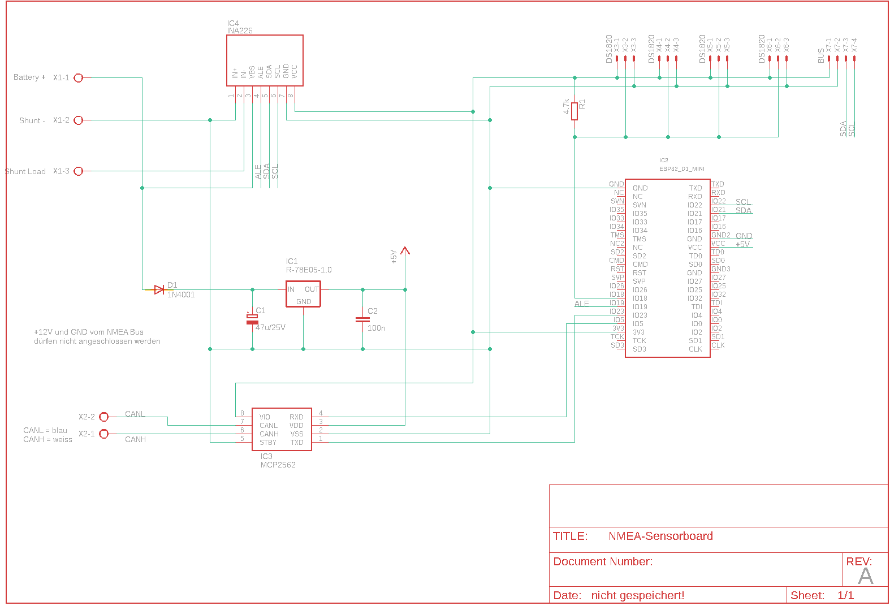

# NMEA2000 Sensorboard

A universal PCB designed to support multiple NMEA 2000 sensor projects based on an ESP32 D1 Mini and an MCP2562 CAN bus transceiver. The board provides a 5 V regulated supply from the NMEA bus power line and exposes connectors for various sensors.

## Schema



## Supported Projects

The board can be used with the following firmware projects:

| Project | Description | Additional Components |
|---------|-------------|----------------------|
| [NMEA2000-DS1820](https://github.com/minou65/NMEA2000-DS1820) | Temperature monitor for up to 4 DS1820 sensors (−50 °C to +125 °C) with configurable alerts | X3–X6, R1 |
| [NMEA2000-FluidLevel](https://github.com/minou65/NMEA2000-FluidLevel) | Tank fill-level monitor using a VL53L0X time-of-flight sensor | X7 |
| [NMEA2000-BME280](https://github.com/minou65/NMEA2000-BME280) | Environmental sensor for temperature, humidity and air pressure | X7 |
| [NMEA2000-BatteryMonitor](https://github.com/minou65/NMEA2000-BatteryMonitor) | Battery monitor using an INA226 (voltage, current, SoC, time-to-go) | X3, R1, IC4 |

Depending on the sensor type, additional external hardware may be required (for example sensors, shunt, cables, housings, adapters, or fuses). The exact requirements are documented in each corresponding project repository.

## Connector Overview

### X1 – Power Input (AK500/3, 3-pin)

| Pin | Signal | Description |
|-----|--------|-------------|
| 1 | NMEA Bus + / Battery + | Positive supply voltage |
| 2 | NMEA Bus - / Shunt - | Negative supply voltage or minus side of shunt |
| 3 | Shunt Load | Load side of shunt |

> **Note:** For all variants except the BatteryMonitor, X1 pin 1 and pin 2 are used. For the BatteryMonitor, all three X1 pins are required.  
> **BatteryMonitor:** NMEA + and NMEA - are not used for sensor supply. The sensor is powered directly from the measured battery via X1.  
> **Warning (BatteryMonitor):** Always install a fuse in the + line between the battery and the sensor board!

---

### X2 – CAN Bus (AK500/2, 2-pin)

| Pin | Signal | Wire colour |
|-----|--------|-------------|
| 1 | CANH | White |
| 2 | CANL | Blue |

---

### X3 – X6 – DS1820 Temperature Sensors (Molex 22-23-2031, 3-pin)

Same pinout on all four connectors. Each connector accepts one DS1820 sensor.  
All four connectors share a common OneWire bus (GPIO 18).

| Pin | Signal | Description |
|-----|--------|-------------|
| 1 | +3.3V | Sensor supply |
| 2 | DATA | OneWire data line |
| 3 | GND | Ground |

---

### X7 – I²C Bus (Molex 22-23-2041, 4-pin)

Used for VL53L0X (FluidLevel) and BME280 sensors.

| Pin | Signal | Description |
|-----|--------|-------------|
| 1 | +3.3V | Sensor supply |
| 2 | GND | Ground |
| 3 | SDA | I²C data (GPIO 21) |
| 4 | SCL | I²C clock (GPIO 22) |

## Supply and Voltage Levels

- Sensor connectors X3-X7 are 3.3 V level.
- For DS1820 on X3-X6: VCC is 3.3 V, DATA is OneWire, GND is pin 3.
- For I2C on X7: pin 1 is 3.3 V, pin 2 is GND, pin 3 is SDA, pin 4 is SCL.
- Board input power is connected via X1.
- In BatteryMonitor mode, supply is taken directly from the measured battery via X1 (not from NMEA + / -).
- Use an input voltage that is within the supported range of the regulator IC1 (R-78E05-1.0).

## Safety and Installation Notes

- Always verify polarity before first power-up.
- BatteryMonitor: install a fuse in the positive line close to the battery.
- BatteryMonitor: keep correct shunt orientation (battery side and load side) to avoid inverted current values.
- Never short the shunt terminals while the battery is connected.
- For high-current installations, use adequately dimensioned cables and secure screw terminals properly.

## Part List

| Part | Value | Device | Package | Notes |
|------|-------|--------|---------|-------|
| C1 | 47 µF / 25 V | CPOL-EUE5-8.5 | E5-8,5 | Bulk decoupling capacitor |
| C2 | 100 nF | C-EU050-024X044 | C050-024X044 | Bypass capacitor |
| D1 | 1N4001 | 1N4148 | SOD80 | Reverse-polarity protection diode |
| IC1 | R-78E05-1.0 | R-78E-XX1.0 | R-78E-XX1.0 | 5 V / 1 A switching regulator |
| IC2 | ESP32 D1 Mini | ESP32_D1_MINI | ESP32_D1_MINI | Main microcontroller |
| IC3 | MCP2562 | MCP2562SMD | SO-8 | CAN bus transceiver |
| IC4 ¹ | INA226 | INA226 | INA226 | Current / power monitor (BatteryMonitor only) |
| R1 ² | 4.7 kΩ | R-EU_R0805 | R0805 | OneWire pull-up (DS1820 / BatteryMonitor) |
| X1 | — | AK500/3 | AK500/3 | Power input connector (3-pin, 2 used) |
| X2 | — | AK500/2 | AK500/2 | CAN bus connector |
| X3 ² | DS1820 | 22-23-2031 | 22-23-2031 | Sensor connector 1 (3-pin Molex) |
| X4 ³ | DS1820 | 22-23-2031 | 22-23-2031 | Sensor connector 2 (3-pin Molex) |
| X5 ³ | DS1820 | 22-23-2031 | 22-23-2031 | Sensor connector 3 (3-pin Molex) |
| X6 ³ | DS1820 | 22-23-2031 | 22-23-2031 | Sensor connector 4 (3-pin Molex) |
| X7 ⁴ | BUS | 22-23-2041 | 22-23-2041 | I²C bus connector (4-pin Molex) |

¹ BatteryMonitor only  
² DS1820 and BatteryMonitor  
³ DS1820 only (up to 4 sensors)  
⁴ FluidLevel and BME280  

## ESP32 D1 Mini Pin Configuration

| Pin | GPIO | Function |
|-----|------|----------|
| CAN Bus TX | GPIO 23 | MCP2562 TXD |
| CAN Bus RX | GPIO 5  | MCP2562 RXD |
| OneWire Data | GPIO 18 | DS1820 Data |

```cpp
#define ESP32_CAN_TX_PIN GPIO_NUM_23    // CAN Bus TX Pin
#define ESP32_CAN_RX_PIN GPIO_NUM_5     // CAN Bus RX Pin
#define ONE_WIRE_BUS     GPIO_NUM_18    // DS18B20 OneWire Data Pin
```

## Component Selection by Variant

| Component | All variants | DS1820 | FluidLevel | BME280 | BatteryMonitor |
|-----------|:-----------:|:------:|:----------:|:------:|:--------------:|
| C1, C2    | ✓ | ✓ | ✓ | ✓ | ✓ |
| D1        | ✓ | ✓ | ✓ | ✓ | ✓ |
| IC1       | ✓ | ✓ | ✓ | ✓ | ✓ |
| IC2       | ✓ | ✓ | ✓ | ✓ | ✓ |
| IC3       | ✓ | ✓ | ✓ | ✓ | ✓ |
| X1 (2-pin)| ✓ | ✓ | ✓ | ✓ | ✓ (3-pin) |
| X2        | ✓ | ✓ | ✓ | ✓ | ✓ |
| R1        |   | ✓ |   |   | ✓ |
| X3        |   | ✓ |   |   | ✓ |
| X4–X6     |   | ✓ |   |   |   |
| X7        |   |   | ✓ | ✓ |   |
| IC4       |   |   |   |   | ✓ |

## License

GPL-3.0 – see [LICENSE](LICENSE)
